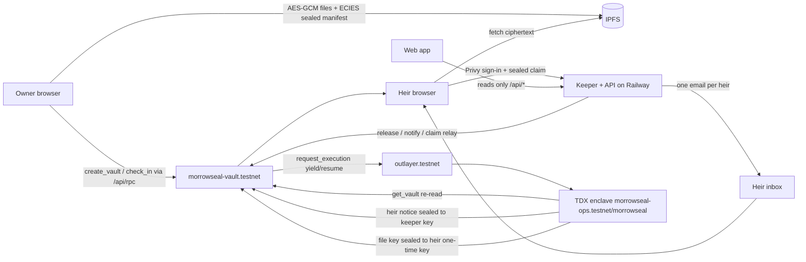

# Morrowseal

A private inheritance vault on NEAR testnet. An owner seals files and a letter for the people they love. The decryption key is held by a secure enclave (an OutLayer worker in Intel TDX). While the owner keeps checking in, nothing can be opened. If they go silent for longer than the interval they chose, the vault is released, each heir gets one email, signs in with that email, and the files decrypt in the heir's own browser.

- **Live app:** https://morrowseal-production.up.railway.app
- **Network:** NEAR testnet only. Do not store real documents yet.
- **Tracks:** `privacy` (TEE / confidential compute, private data never on chain), `realworld` (estate planning a normal family can use: email sign-in, no wallet, no seed phrase)


## The problem

Passwords, crypto keys and family documents die with their owner, or they are handed over too early to a lawyer, a cloud provider or a relative. A dead-man's switch usually means trusting a company with plaintext, or putting secrets on a public chain. Morrowseal releases a secret only when the owner stops checking in, without any server, chain observer or keeper ever seeing the contents.

## How it works

| Stage | What happens | Where |
| --- | --- | --- |
| Seal | Files are encrypted with AES-256-GCM in the browser. File key, file list, letter, owner email and heir names/emails are ECIES-sealed to the enclave public key. Ciphertext is pinned to IPFS. | Owner browser |
| Register | `create_vault(commitment, cid, heirs, interval_s, grace_s)` stores a SHA-256 commitment, the IPFS CID, the heir **count** and times. | `morrowseal-vault.testnet` |
| Check in | `check_in(vault_id)` resets the clock. Any edit also counts. | NEAR |
| Release | After `interval + grace` of silence anyone may call `release`; the keeper does it automatically. | NEAR |
| Notify | `notify` calls `outlayer.testnet.request_execution` (yield/resume). The enclave re-reads the vault over NEAR RPC, checks status and commitment, and returns heir names, emails and one-time claim tokens sealed to the keeper key. | OutLayer TEE |
| Email | The keeper decrypts the notice and sends each heir one email with one button. | Keeper |
| Claim | The heir signs in with Privy (email code or Google). The browser seals `{token, one-time pubkey, Privy token}` to the enclave; `claim` -> enclave checks the token and that Privy's verified email equals the sealed heir email, then re-seals the file key to the heir's one-time key on chain. | OutLayer TEE + NEAR |
| Open | The heir's browser unseals the key, fetches ciphertext from IPFS and decrypts locally. | Heir browser |

## Architecture



The web app never reads the chain directly: the keeper serves a read model (`/api/vaults`, `/api/activity`, `/api/shared`, `/api/config`) mirrored from contract views, plus a same-origin JSON-RPC proxy (`/api/rpc`) for signed transactions.

## What is private vs public

| Data | On NEAR (public) | On IPFS | Keeper | Enclave |
| --- | --- | --- | --- | --- |
| Files, letter | never | ciphertext only | never | file key, only at claim |
| Heir names / emails | count only | inside sealed blob | HMAC index at seal time; plaintext only after release (to send mail) | yes |
| Vault title, owner display name | never | inside sealed blob | owner name after release | yes |
| Claim token | never (sealed to enclave) | — | after release | derived (HMAC of a TEE secret) |
| Who claimed | heir's NEAR implicit account + "email verified" flag | — | — | — |
| Times, status, check-ins | yes | — | yes | — |

## Trust model

- **Enclave (OutLayer TDX):** holds the master secret (`PROTECTED_MORROWSEAL_MASTER`, generated inside the TEE). Trusted to release a file key only for a Released vault whose commitment matches, and only to a sign-in whose Privy-verified email equals the sealed heir email.
- **NEAR contract:** source of truth for status, deadlines and claims. Release is permissionless after the deadline, so no single party can stop or speed it.
- **Keeper:** liveness only (calls `release`/`notify`, sends mail, relays claims so heirs need no NEAR). It never sees file keys. It does see heir emails after release, and a keyed hash of heir emails at seal time (for "Shared with me").
- **Privy:** holds users' NEAR keys (embedded ed25519 wallets) and attests which emails belong to a sign-in. The enclave trusts Privy's answer.
- **IPFS:** availability only; everything there is ciphertext.

## Deployed ids and versions

| Piece | Id / version |
| --- | --- |
| Vault contract | `morrowseal-vault.testnet` (Rust, near-sdk 5.17, crate v0.1.0) |
| Admin / keeper account | `morrowseal-ops.testnet` |
| OutLayer project | `morrowseal-ops.testnet/morrowseal` (enclave crate v0.1.0, `wasm32-wasip2`) |
| Enclave wasm sha256 | `9b1d03ac3a895ee7b4f4738493c422dea0cf2bac386c7806999ca17ba5f211a1` |
| Enclave public key | `02c2a3119b44700420af138a0918682a074a162e7a10200c4234b5da8383cd6977` |
| Demo owner | `morrowseal-demo.testnet` |
| Transactions | every create / release / notify / claim hash is in `deployments/morrowseal.json` |

## NEAR-native components

- **NEAR smart contract** (`contracts/vault`): vaults, check-ins, permissionless release, claims, event log, views.
- **OutLayer TEE** (`enclave/`): confidential compute for `notify`, `claim` and `owner_open`, with an on-chain result.
- **Yield/resume:** the contract calls `outlayer.testnet.request_execution` and resumes in `on_notify` / `on_claim` / `on_owner_open` callbacks with the enclave's answer.
- **Privy NEAR accounts:** every owner and heir gets a NEAR testnet implicit account (Privy extended-chain wallet, `chainType: near`, signed with raw-hash signing), topped up once by the keeper. No wallet extension, no seed phrase.

## Judge walkthrough (do X - see Y)

All against https://morrowseal-production.up.railway.app. Steps 1-4 need no sign-in.

1. **Open `/`** - see the landing page ("Leave the keys. Keep the secret.").
2. **Open `/app?watch=morrowseal-demo.testnet`** - see a read-only workspace with released/opened demo vaults. Click one - see its timeline (sealed -> released -> enclave sealed notices -> heirs emailed -> claimed) with NearBlocks links.
3. **Open `/app/proof?watch=morrowseal-demo.testnet`** - see the raw `get_vault` JSON (hash, CID, counts, times only) next to the list of what only the enclave sees.
4. **`curl https://morrowseal-production.up.railway.app/api/vaults/1`** - see that the public record contains no names, emails, titles or contents.
5. **Sign in** (email code or Google) - see a NEAR testnet account created and funded in the sidebar account card, with a DiceBear avatar.
6. **Create -> pick "2 min (demo)" -> add yourself (another email you own) as heir -> seal** - see the vault on Vaults; the heir gets a "you've been named" email.
7. **Sign in as the heir and open Shared with me** - see the vault as *Waiting*. Wait ~2 minutes without checking in - it becomes *Released* and the heir gets the claim email.
8. **Click Open (from the email or Shared with me)** - the enclave checks the email; the letter and files decrypt in the browser. The row becomes *Opened* and can be reopened from the same browser.
9. **Open Activity** (as owner or heir) - see only your own events: created, check-ins, released, heirs notified, claims you made, cancelled; times in your local timezone.

| Workspace | Create | Claim |
| --- | --- | --- |
|  |  |  |

## Repo

```
contracts/vault   NEAR contract (Rust): vaults, check-ins, release, TEE notify/claim callbacks, events, views
enclave/          OutLayer WASI worker: notify / claim / owner_open, Privy token check, RPC re-read
shared/           crypto shared by browser, keeper and scripts (AES-GCM, ECIES, vault/claim builders)
keeper/           deadline watcher, heir mail, heir HMAC index, read-model API, RPC proxy, claim relay, serves web/dist
web/              Vite + React app: landing, owner workspace, Shared with me, heir claim
scripts/          deploy-near.mjs, e2e.mjs
docs/             threat model, screenshots
```

## Run locally

Requirements: Node 20+, Rust stable with `wasm32-wasip2`, `cargo-near`, the `outlayer` CLI (only to redeploy the enclave).

```sh
npm ci && (cd web && npm ci)
cp .env.example ../my.env        # fill in your own values; never commit
set -a; . ../my.env; set +a
(cd web && npx vite build)
PORT=3000 APP_URL=http://localhost:3000 SERVE_WEB=1 DATA_DIR=./data node keeper/index.mjs
# open http://localhost:3000
```

Build and test the Rust parts:

```sh
(cd contracts/vault && cargo test && cargo near build non-reproducible-wasm)
(cd enclave && cargo build --release --target wasm32-wasip2)
```

## Limitations

- Testnet only; one enclave deployment and one keeper. If OutLayer is unavailable, released vaults wait until it returns (see `docs/threat-model.md`).
- The keeper sees heir emails after release (it must send mail) and an HMAC of heir emails at seal time. It never sees file keys or contents.
- "Shared with me" for still-waiting vaults relies on the seal-time hint the owner's browser sends; it is confirmed from the enclave's notice once released. Vaults sealed before this index existed appear only after release.
- A share can be claimed once (on chain). Reopening works in the browser that claimed it; another device shows it as already opened.
- Privy holds users' NEAR keys; the enclave trusts Privy's verified-email answer.
- Vault titles live in the owner's browser; another device shows "Vault N".
