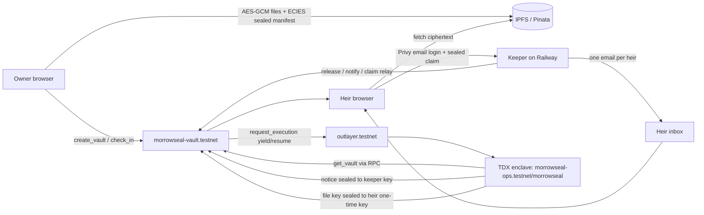

# Morrowseal

A private inheritance vault on NEAR. You seal files and a message for the people you love. The key is held by a secure enclave (an OutLayer worker running in Intel TDX). If you stop checking in, your heirs get a calm email, sign in with that email, and the enclave releases the key to their browser. The blockchain only ever stores commitments.

- **Tracks:** `privacy` (TEE, confidential compute), `realworld` (estate planning for normal families)
- **Network:** NEAR testnet only. Do not use for real documents yet.
- **Live app:** see `deployments/morrowseal.json` (`app_url`)

## The problem

Crypto keys, passwords and documents die with their owner, or are handed to a lawyer, a server or a family member long before they're needed. A dead-man's switch normally means trusting a company with plaintext, or putting the secret (or the heirs' identities) on a public chain.

## What Morrowseal does

| Stage | What happens | Where |
| --- | --- | --- |
| Seal | Files are encrypted with AES-256-GCM in the browser. The file key, file list, message and heir names/emails are sealed with ECIES to the enclave's public key. Ciphertext goes to IPFS (Pinata). | Browser |
| Register | `create_vault(commitment, cid, heirs, interval_s, grace_s)` stores a SHA-256 commitment, the IPFS CID of ciphertext, a heir **count**, and times. | `morrowseal-vault.testnet` |
| Check in | `check_in(vault_id)` resets the clock. Any edit also counts. | NEAR |
| Release | After `interval + grace` of silence anyone may call `release`. The keeper does it automatically. | NEAR |
| Notify | `notify` calls `outlayer.testnet.request_execution` (yield/resume). The enclave re-reads the vault from NEAR RPC, checks it is Released and the hash matches, then returns heir names, emails and one-time claim tokens **sealed to the mail keeper's key**. | OutLayer TEE |
| Email | The keeper decrypts the notice and sends each heir one calm email with one button (Brevo, sender "Vault Keeper"). | Keeper |
| Claim | The heir opens the link and signs in with **email + one-time code (Privy)**. The browser seals `{token, one-time public key, Privy access token}` to the enclave. `claim` → enclave verifies the token (HMAC), verifies the Privy access token (ES256 against the app JWKS, issuer `privy.io`, audience = Morrowseal app id), asks Privy over TLS from inside the TEE which email is linked, checks it equals the named heir, and re-seals the file key to the heir's one-time key. | OutLayer TEE |
| Open | The heir's browser decrypts the key, fetches ciphertext from IPFS and decrypts the files locally. | Browser |

### What is public vs private

| Data | On NEAR | On IPFS | Keeper | Enclave |
| --- | --- | --- | --- | --- |
| Files, message | — | ciphertext | — | file key only at claim |
| Heir names/emails | count only | inside sealed blob | after release only | yes |
| Vault title | — | — | — | — (stays in the owner's browser) |
| Claim token | never (sealed to enclave) | — | after release | derived (HMAC of a TEE secret) |
| Who claimed | the heir's NEAR implicit account, "email verified" flag | — | — | — |

## Try it (judges: do X, see Y)

1. **Open the live app** → landing page with "Leave the keys. Keep the secret."
2. **See the proof without a wallet:** open `/app/proof?watch=morrowseal-demo.testnet` → left column shows raw `get_vault` JSON (only hash, CID, counts, times, ciphertext); right column lists what only the enclave sees.
3. **Browse a real released vault:** `/app?watch=morrowseal-demo.testnet` → Metal UI folder shelf with RELEASED/OPENED vaults; click one → history timeline (sealed → released → enclave sealed heir notices → heirs emailed → an heir opened it).
4. **Activity:** `/app/activity` → paginated public events from the contract with local times and NearBlocks links.
5. **Create your own:** click **Sign in**, enter your email and the one-time code (Privy). A NEAR testnet account is created and funded for you. Go to **Create** → vertical 5-step stepper → choose "2 min (demo)" and "None" grace → **Seal vault**.
6. **Miss the check-in:** wait ~2 minutes → the keeper releases the vault, the enclave seals the notice, the heir email arrives ("<your name> left something for you", one button).
7. **Claim as the heir:** open the email button → **Continue with email** → enter the heir email and the one-time code → the enclave checks the email with Privy → the letter and files appear, decrypted in the browser.
   - Works on the hosted URL; no wallet needed by anyone.
8. **Script version (no browser):** `node scripts/e2e.mjs create` then `node scripts/e2e.mjs token-claim <id>` runs create → lapse → release → TEE notify → claim → decrypt and prints the plaintext.

## Verified testnet run (2026-10-20 UTC)

See `deployments/morrowseal.json` for every id and transaction hash, including a full email-login claim where the enclave reported `verified_email: true`.

## Architecture



| Piece | Id |
| --- | --- |
| Vault contract | `morrowseal-vault.testnet` (Rust, near-sdk 5.17) |
| Admin / mail keeper account | `morrowseal-ops.testnet` |
| OutLayer project | `morrowseal-ops.testnet/morrowseal` (secret `PROTECTED_MORROWSEAL_MASTER`, generated in the TEE) |
| Enclave public key | `02c2a3119b44700420af138a0918682a074a162e7a10200c4234b5da8383cd6977` |
| Enclave wasm | sha256 in `deployments/morrowseal.json`, hosted on FastFS |
| Sign-in (owners and heirs) | Privy email login, app `cmvgf5ust01v70gkt4l67ge2q`; NEAR implicit accounts via Privy extended-chain wallets (`chainType: near`) |
| Account top-up | keeper `POST /api/fund`, 0.25 NEAR once per Privy user, from `morrowseal-ops.testnet` |

NEAR features used: OutLayer TEE via yield/resume, implicit accounts (ed25519, one per user, held by Privy and signed with raw signing), named accounts, NEP-297 style event logs.

Sign-in: Privy email login is the only login, for owners and heirs. Each user gets a NEAR testnet implicit account on first sign-in; the keeper tops it up once with 0.25 NEAR (`POST /api/fund`, checks the Privy access token, once per user).

## Repo

```
contracts/vault   NEAR contract: vaults, check-ins, release, TEE notify/claim callbacks, events, views
enclave/          OutLayer WASI (wasm32-wasip2): pubkey / notify / claim, ES256 Privy identity-token check, RPC re-read
shared/           crypto shared by browser, keeper and scripts (AES-GCM, ECIES, vault/claim builders)
keeper/           deadline watcher, heir mail (Brevo), IPFS pin/fetch API, claim relay, serves web/dist
web/              Vite + React app: landing, owner workspace, heir claim
scripts/          deploy-near.mjs, e2e.mjs
docs/             threat model, screenshots
```

## Run locally

Requirements: Node 20, Rust stable with `wasm32-wasip2`, `cargo-near`, the `outlayer` CLI.

```sh
npm ci && (cd web && npm ci)
cp .env.example ../my.env   # fill in your own values; never commit
set -a; . ../my.env; set +a
(cd web && npx vite build)
PORT=3000 APP_URL=http://localhost:3000 SERVE_WEB=1 node keeper/index.mjs
# open http://localhost:3000
```

Build and test:

```sh
(cd contracts/vault && cargo test && cargo near build non-reproducible-wasm)
(cd enclave && cargo build --release --target wasm32-wasip2)
```

## Limits and honest notes

- Testnet only; the enclave key and keeper are a single deployment. If OutLayer disappears, sealed vaults cannot be released (see `docs/threat-model.md` for the guardian backup we'd add).
- The keeper learns heir emails after release (it must, to send mail). It never sees file keys or contents.
- Privy holds the users' NEAR keys (embedded wallets). The enclave trusts Privy's answer about which email belongs to a sign-in.
- Heir emails are sent from `vaultkeeper@agentmail.to` through Brevo. That domain publishes `DMARC p=reject`, so strict receivers (Gmail, AgentMail) may drop them. Production needs a sender on a domain authenticated in Brevo.
- Owner names and titles live in the owner's browser (`localStorage`); another device shows "Vault N".
