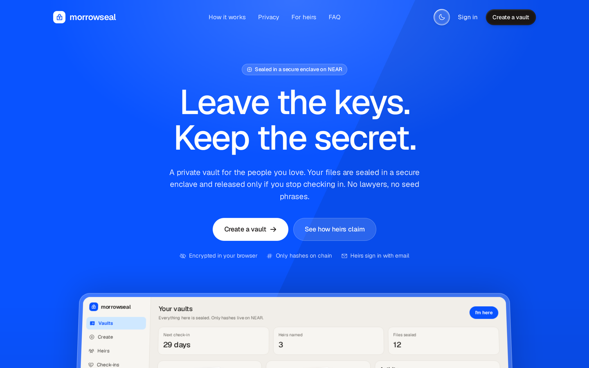
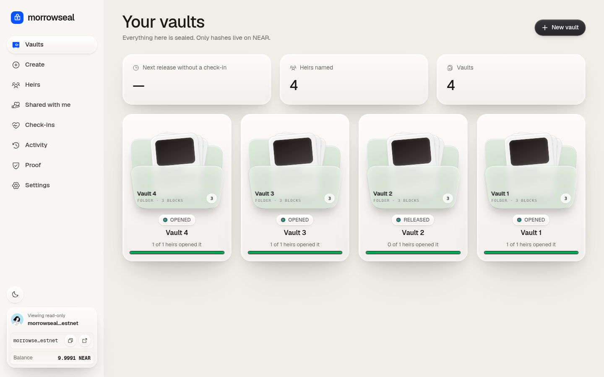
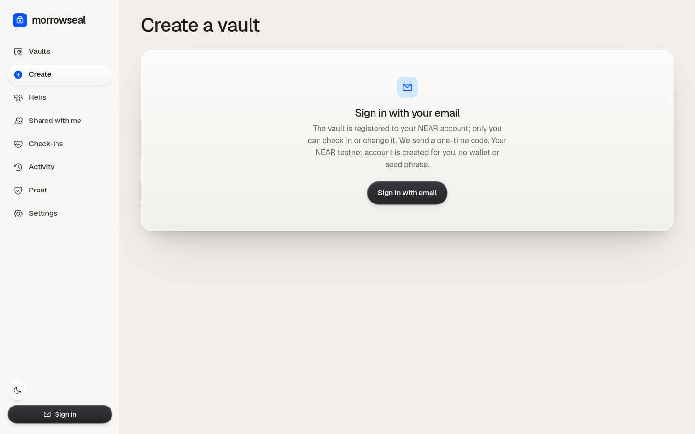
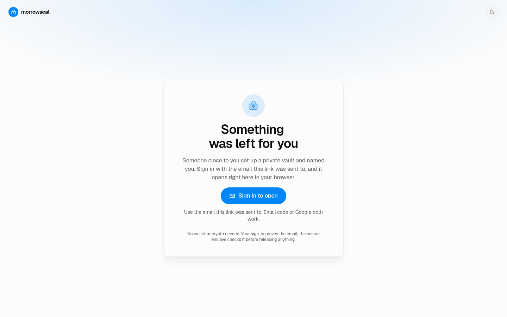
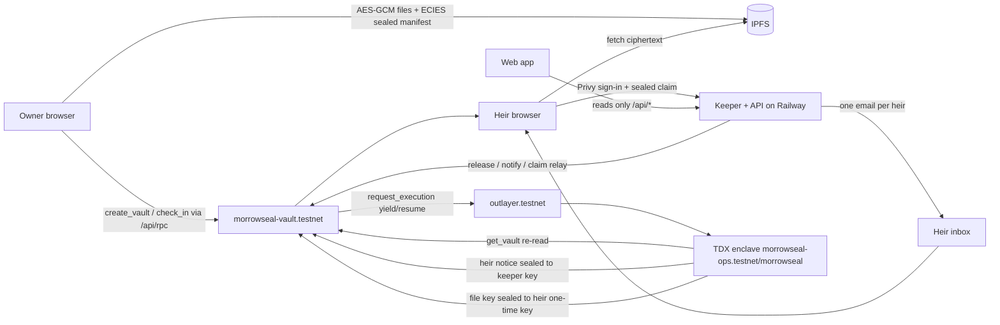

# Morrowseal

A private inheritance vault on NEAR testnet with a dead-man timer. Files are encrypted in the owner's browser; the key and the heir list are sealed to an OutLayer TEE enclave. If the owner stops checking in, the vault is released on chain and each named heir opens it by signing in with their email. NEAR only ever stores a commitment, an IPFS address of ciphertext, an heir count and timestamps.

- **Try it:** [https://morrowseal-production.up.railway.app](https://morrowseal-production.up.railway.app) (testnet), or [run it locally](#run-locally) at `http://localhost:3000`.
- **Network:** NEAR testnet only. Do not store real documents yet.
- **Tracks:** `open` (Open Innovation, primary) and `privacy` (TEE, confidential compute: plaintext and heir identities never on chain)
- **For AI reviewers:** [AGENTS.md](AGENTS.md) (features, ids, claim-to-code map) and [llms.txt](llms.txt)



## Contents

- [The stakes](#the-stakes)
- [Why current options fail](#why-current-options-fail)
- [Try it in 2 minutes (do X - see Y)](#try-it-in-2-minutes-do-x---see-y)
- [Evaluate it in ten minutes (do X - see Y)](#evaluate-it-in-ten-minutes-do-x---see-y)
- [Life of a vault](#life-of-a-vault)
- [Architecture](#architecture)
- [What is private vs public](#what-is-private-vs-public)
- [Why it has to be NEAR](#why-it-has-to-be-near)
- [NEAR-native components](#near-native-components)
- [Hackathon tracks: open + privacy](#hackathon-tracks-open--privacy)
- [Libraries and baseline](#libraries-and-baseline)
- [Demo post](#demo-post)
- [Verify it yourself](#verify-it-yourself)
- [Threat model (short)](#threat-model-short)
- [Trust model](#trust-model)
- [Deployed ids and versions](#deployed-ids-and-versions)
- [Repo](#repo)
- [Run locally](#run-locally)
- [Limitations](#limitations)

## The stakes

Self-custody has no recovery desk. When the only person who knows a seed phrase, a password manager's master key or where the documents are dies or loses capacity, that access is usually gone for good, and the family often does not even know what existed.

## Why current options fail

| Option | What goes wrong |
| --- | --- |
| Write it down for a relative | The secret is exposed years early, and can be lost, found or misused. |
| Lawyer, bank or custodian | A third party holds plaintext; slow, costly, and tied to one jurisdiction. |
| Hosted dead-man's switch | The operator can read the secret and can shut down. |
| Put it on a public chain | Everything on chain is readable forever. |
| Multisig / social recovery | Needs heirs to run wallets and coordinate; reveals who the heirs are. |

## Try it in 2 minutes (do X - see Y)

No sign-in, no email needed.

1. **Open [`/app?watch=morrowseal-demo.testnet`](https://morrowseal-production.up.railway.app/app?watch=morrowseal-demo.testnet) and click a vault** - see a demo vault's timeline (sealed -> released -> heirs emailed -> claimed) with NearBlocks links.
2. **Open [`/app/proof?watch=morrowseal-demo.testnet`](https://morrowseal-production.up.railway.app/app/proof?watch=morrowseal-demo.testnet)** - see the raw on-chain record (hash, CID, counts, times only) next to what only the enclave sees.
3. **Run `curl https://morrowseal-production.up.railway.app/api/vaults/1`** - see that the public record holds no names, emails, titles or contents.

For the full flow (create, release, heir opens), use the ten-minute steps below.

## Evaluate it in ten minutes (do X - see Y)

All against [https://morrowseal-production.up.railway.app](https://morrowseal-production.up.railway.app) or a local run at `http://localhost:3000`. Steps 1-4 need no sign-in.

1. **Open `/`** - see the landing page ("Leave the keys. Keep the secret.").
2. **Open `/app?watch=morrowseal-demo.testnet` and click a vault** - see a read-only workspace with released/opened demo vaults and the clicked vault's timeline (sealed -> released -> enclave sealed notices -> heirs emailed -> claimed) with NearBlocks links.
3. **Open `/app/proof?watch=morrowseal-demo.testnet`** - see the raw `get_vault` JSON (hash, CID, counts, times only) next to the list of what only the enclave sees.
4. **`curl https://morrowseal-production.up.railway.app/api/vaults/1`** - see that the public record contains no names, emails, titles or contents.
5. **Sign in (email code or Google)** - see a NEAR testnet account created and funded in the sidebar account card, with a DiceBear avatar.
6. **Create -> pick "2 min (demo)" -> add yourself (another email you own) as heir -> seal** - see the vault on Vaults; the heir gets a "you've been named" email.
7. **Sign in as the heir and open Shared with me** - see the vault as *Waiting*. Wait ~2 minutes without checking in - it becomes *Released* and the heir gets the claim email.
8. **Click Open (from the email or Shared with me)** - see the enclave check the email and the letter and files decrypt in the browser. The row becomes *Opened*; Reopen works on any device or browser after signing in with the heir email.
9. **Open Activity (as owner or heir)** - see only your own events: created, check-ins, released, heirs notified, claims you made, cancelled; times in your local timezone.

| Workspace | Create | Claim |
| --- | --- | --- |
|  |  |  |

## Life of a vault

| Stage | What happens | Where |
| --- | --- | --- |
| Seal | Files are encrypted with AES-256-GCM in the browser. File key, file list, letter, owner email and heir names/emails are ECIES-sealed to the enclave public key. Ciphertext is pinned to IPFS. | Owner browser |
| Register | `create_vault(commitment, cid, heirs, interval_s, grace_s)` stores a SHA-256 commitment, the IPFS CID, the heir **count** and times. | `morrowseal-vault.testnet` |
| Check in | `check_in(vault_id)` resets the clock. Any edit also counts. | NEAR |
| Release | After `interval + grace` of silence anyone may call `release`; the keeper does it automatically. | NEAR |
| Notify | `notify` calls `outlayer.testnet.request_execution` (yield/resume). The enclave re-reads the vault over NEAR RPC, checks status and commitment, and returns heir names, emails and one-time claim tokens sealed to the keeper key. | OutLayer TEE |
| Email | The keeper decrypts the notice and sends each heir one email with one button. | Keeper |
| Claim | The heir signs in with Privy (email code or Google). The browser seals `{token, one-time pubkey, Privy token}` to the enclave; `claim` -> enclave checks the token and that Privy's verified email equals the sealed heir email, then re-seals the file key to the heir's one-time key on chain. | OutLayer TEE + NEAR |
| Open | The heir's browser unseals the key, fetches ciphertext from IPFS and decrypts locally. | Heir browser |

## Architecture



The web app never reads the chain directly: the keeper serves a read model (`/api/vaults`, `/api/activity`, `/api/shared`, `/api/config`) mirrored from contract views, plus a same-origin JSON-RPC proxy (`/api/rpc`) for signed transactions.

## What is private vs public

| Data | On NEAR (public) | On IPFS | Keeper | Enclave |
| --- | --- | --- | --- | --- |
| Files, letter | never | ciphertext only | never | file key, only at claim |
| Heir names / emails | count only | inside sealed blob | HMAC index at seal time; plaintext only after release (to send mail) | yes |
| Vault title, owner display name | never | inside sealed blob | owner name after release | yes |
| Claim token | never (sealed to enclave) | — | after release | derived (HMAC of a TEE secret) |
| Who claimed | heir's NEAR implicit account + "email verified" flag | — | — | — |
| Times, status, check-ins | yes | — | yes | — |

## Why it has to be NEAR

- **Contract as the clock:** check-ins, deadlines, permissionless `release` and the claim record live in `morrowseal-vault.testnet`; nobody can stop or speed a release.
- **Yield/resume into a TEE:** `notify`, `claim`, `heir_open` and `owner_open` call `outlayer.testnet.request_execution` and resume in a callback with the enclave's answer, so the confidential step is part of a NEAR transaction.
- **Accounts without wallets:** every owner and heir gets a NEAR implicit account through Privy (email code or Google); the keeper funds new accounts once and pays for every heir-side transaction.

## NEAR-native components

- **NEAR smart contract** (`contracts/vault`): vaults, check-ins, permissionless release, claims, event log, views.
- **OutLayer TEE** (`enclave/`): confidential compute for `notify`, `claim`, `heir_open` and `owner_open`, with an on-chain result.
- **Yield/resume:** the contract calls `outlayer.testnet.request_execution` and resumes in `on_notify` / `on_claim` / `on_heir_open` / `on_owner_open` callbacks with the enclave's answer.
- **Privy NEAR accounts:** every owner and heir gets a NEAR testnet implicit account (Privy extended-chain wallet, `chainType: near`, signed with raw-hash signing), topped up once by the keeper. No wallet extension, no seed phrase.

## Hackathon tracks: open + privacy

Built at NEAR HACKATHON 2026. Tracks:

- `open` (Open Innovation, primary): the track's own example idea is an inheritance account, where an owner checks in on a schedule and, after missed check-ins and a waiting period the owner can cancel, assets go to named heirs. Morrowseal applies that idea to what people actually want to pass on (files, a letter, secrets) rather than funds held in a contract: the owner checks in, a missed deadline releases the vault, and only the named heirs can open it.

- `privacy` (Privacy & Private AI: "confidential computation ... AI that protects sensitive data", hint "TEE"): the sensitive data here is a person's files, letter and heir list. They are encrypted or sealed in the owner's browser, and the key and heir list can be opened only inside an OutLayer enclave (Intel TDX) that releases a key only for a Released vault and only to a sign-in whose Privy-verified email matches the sealed heir email. `notify`, `claim`, `heir_open` and `owner_open` run that enclave via `outlayer.testnet.request_execution` (yield/resume) inside NEAR transactions. NEAR stores only a commitment, an IPFS CID of ciphertext, an heir count and timestamps.
- Limits, so the claim is not read as more than it is: there is no AI in this app. The keeper sees heir emails after release (it sends the mail) and an HMAC of them at seal time. Privy holds users' NEAR keys and the enclave trusts Privy's verified-email answer. Everything is testnet-only with one enclave deployment. See [Threat model](#threat-model-short) and [Limitations](#limitations).

## Libraries and baseline

**Baseline.** There is no pre-hackathon baseline in this repository. All code was written from 2026-10-20 onward (first commit 2026-10-20 UTC), inside the window that began on 2026-10-19 (Q-001). AI coding tools were used to write and edit code and docs.

**Dependencies** (from `package.json`, `web/package.json`, `contracts/vault/Cargo.toml` and `enclave/Cargo.toml`):

- Keeper / shared (Node 20+): `eciesjs`, `jose`, `near-api-js` (v5).
- Web app: `react`, `react-dom`, `react-router-dom`, `vite`, `@vitejs/plugin-react`, `typescript`, `near-api-js` (v7), `eciesjs`, `@privy-io/react-auth`, `@solana/kit`, `@solana-program/system`, `@solana-program/token`, `@phosphor-icons/react`, `@dicebear/core`, `@dicebear/collection`, `tailwindcss`, `motion`, `next-themes`, `lucide-react` (beUI components, MIT, copied into `web/src/components/motion`), `buffer`. Fonts Geist and OpenRunde (SIL OFL, files in `web/public/fonts`).
- NEAR contract (Rust): `near-sdk` 5.17, `serde_json`, `hex`.
- Enclave (Rust, `wasm32-wasip2`): `serde`, `serde_json`, `sha2`, `hmac`, `hkdf`, `hex`, `base64`, `p256`, `ecies`, `libsecp256k1`, `wasi-http-client`.

**External pieces:**

- OutLayer (`outlayer.testnet`, TEE on Intel TDX): runs the enclave worker; the wasm is served from FastFS.
- Privy: email-code and Google sign-in, and embedded NEAR implicit-account wallets.
- IPFS pinning and gateways (Pinata, with public gateway fallbacks) for ciphertext.
- Email delivery for heir notices: AgentMail, with Brevo as the fallback transport.
- NEAR testnet RPC, NearBlocks (explorer links), Railway (hosting).

## Demo post

Demo post on X: added on 2026-11-01

## Verify it yourself

| Check | How | Code |
| --- | --- | --- |
| The public record has no names, emails or contents | `curl https://morrowseal-production.up.railway.app/api/vaults/1` or view `get_vault` on [NearBlocks](https://testnet.nearblocks.io/address/morrowseal-vault.testnet) | `contracts/vault/src/lib.rs` `struct Vault` |
| Release and claims are real NEAR transactions that call OutLayer | Look up the hashes in `deployments/morrowseal.json` on NearBlocks; look for `request_execution` and the `on_claim` callback | `contracts/vault/src/lib.rs` `tee`, `on_claim` |
| The enclave checks the heir's email | Read the `claim` / `heir_open` branches | `enclave/src/main.rs`, `enclave/src/jwt.rs` `verified_email` |
| Encryption happens in the browser | Read `buildVault` (AES-256-GCM files, ECIES-sealed manifest) | `shared/morrowseal.mjs` |
| The running enclave is this code | Download the wasm from FastFS (URL in AGENTS.md), check its sha256 is `2eefb0e9…a71b`, and compare with the OutLayer project's active version; a local rebuild needs the same toolchain and `PRIVY_APP_ID` | `enclave/` |
| Activity is per user | `curl https://morrowseal-production.up.railway.app/api/activity` with no owner returns `[]` | `keeper/index.mjs` `/api/activity` |

## Threat model (short)

- **Chain observers** see a hash, a CID, an heir count, times, status and which NEAR account claimed. Not names, emails, titles, letters or files.
- **IPFS** holds ciphertext only.
- **Keeper** never sees file keys or contents. It sees heir emails after release (to send mail) and stores only an HMAC of heir emails before release (for "Shared with me").
- **Enclave** is trusted to release a key only for a Released vault with a matching commitment, and only to a sign-in whose Privy-verified email matches the sealed one.
- **Privy** holds users' NEAR keys and attests which emails belong to a sign-in; a compromise of Privy would undermine heir verification.
- Full model: `docs/threat-model.md`; trust details below.

## Trust model

- **Enclave (OutLayer TDX):** holds the master secret (`PROTECTED_MORROWSEAL_MASTER`, generated inside the TEE). Trusted to release a file key only for a Released vault whose commitment matches, and only to a sign-in whose Privy-verified email equals the sealed heir email.
- **NEAR contract:** source of truth for status, deadlines and claims. Release is permissionless after the deadline, so no single party can stop or speed it.
- **Keeper:** liveness only (calls `release`/`notify`, sends mail, relays claims so heirs need no NEAR). It never sees file keys. It does see heir emails after release, and a keyed hash of heir emails at seal time (for "Shared with me").
- **Privy:** holds users' NEAR keys (embedded ed25519 wallets) and attests which emails belong to a sign-in. The enclave trusts Privy's answer.
- **IPFS:** availability only; everything there is ciphertext.

## Deployed ids and versions

| Piece | Id / version |
| --- | --- |
| Vault contract | `morrowseal-vault.testnet` (Rust, near-sdk 5.17, crate v0.1.0) |
| Admin / keeper account | `morrowseal-ops.testnet` |
| OutLayer project | `morrowseal-ops.testnet/morrowseal` (enclave crate v0.1.0, `wasm32-wasip2`) |
| Enclave wasm sha256 | `2eefb0e9302e312d8e56bd43663cd602f8b2daa82eb2cd82c193b4c006b1a71b` |
| Enclave public key | `02c2a3119b44700420af138a0918682a074a162e7a10200c4234b5da8383cd6977` |
| Demo owner | `morrowseal-demo.testnet` |
| Transactions | every create / release / notify / claim hash is in `deployments/morrowseal.json` |

## Repo

```
contracts/vault   NEAR contract (Rust): vaults, check-ins, release, TEE notify/claim callbacks, events, views
enclave/          OutLayer WASI worker: notify / claim / owner_open, Privy token check, RPC re-read
shared/           crypto shared by browser, keeper and scripts (AES-GCM, ECIES, vault/claim builders)
keeper/           deadline watcher, heir mail, heir HMAC index, read-model API, RPC proxy, claim relay, serves web/dist
web/              Vite + React app: landing, owner workspace, Shared with me, heir claim
scripts/          deploy-near.mjs, e2e.mjs
docs/             threat model, screenshots
```

## Run locally

Requirements: Node 20+, Rust stable with `wasm32-wasip2`, `cargo-near`, the `outlayer` CLI (only to redeploy the enclave).

```sh
npm ci && (cd web && npm ci)
cp .env.example ../my.env        # fill in your own values; never commit
set -a; . ../my.env; set +a
(cd web && npx vite build)
PORT=3000 APP_URL=http://localhost:3000 SERVE_WEB=1 DATA_DIR=./data node keeper/index.mjs
# open http://localhost:3000
```

Build and test the Rust parts:

```sh
(cd contracts/vault && cargo test && cargo near build non-reproducible-wasm)
(cd enclave && cargo build --release --target wasm32-wasip2)
```

## Limitations

- Testnet only; one enclave deployment and one keeper. If OutLayer is unavailable, released vaults wait until it returns (see `docs/threat-model.md`).
- The keeper sees heir emails after release (it must send mail) and an HMAC of heir emails at seal time. It never sees file keys or contents.
- "Shared with me" for still-waiting vaults relies on the seal-time hint the owner's browser sends; it is confirmed from the enclave's notice once released. Vaults sealed before this index existed appear only after release.
- The first claim of each share is recorded on chain once. After that the heir can reopen it any number of times, on any device, by signing in with the named email (`heir_open`: the enclave re-checks the email and re-seals the key to that browser). Each reopen is a relayed TEE call paid by the keeper.
- Privy holds users' NEAR keys; the enclave trusts Privy's verified-email answer.
- Vault titles and heir names (device notes) sync across the owner's devices as an AES-256-GCM blob the server cannot read: the key is HKDF of a deterministic ed25519 signature by the owner's own Privy-held NEAR key over a fixed domain-separated message. The keeper stores ciphertext on its volume, keyed by Privy user id. Anyone who controls the owner's Privy login can derive the key. Heir names and emails can be restored on any device with **Show heir details** (owner-verified enclave open, vaults #7+), and are then kept only in that device's storage.

## License

MIT, see [LICENSE](LICENSE).
